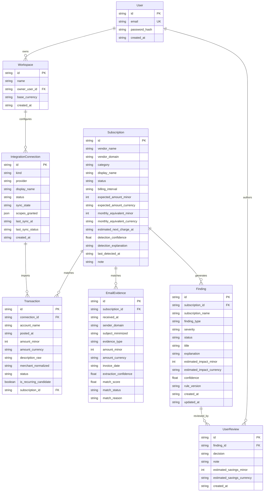

# System Architect & Technical Governance

## Role Description
You are the System Architect for SubTracker. You define the technical architecture, domain models, entity relationships, and systemic constraints.

## Architecture Principles

### 1. Strict Client-Server Decoupling
- The system is divided cleanly into `frontend/` and `backend/`.
- Frontend communicates with backend exclusively via HTTP REST over JSON adhering to the OpenAPI 3.0 specification (`contract/openapi.yaml`).
- Zero direct database access from frontend code.

### 2. Zero External SaaS / Local Execution
- Zero external cloud database dependencies (no Supabase, DynamoDB, or external cloud DB required for operation).
- Local storage default using SQLite (`subtracker.db` / `app.db`) managed through SQLAlchemy ORM.
- Database-agnostic design: configurable via `DATABASE_URL` environment variable for future PostgreSQL / MySQL deployments.
- Synthetic ingestion harnesses provide realistic bank transactions and email evidence locally without live third-party API dependencies.

## Entity Relationship Diagram (ERD)

## Issue Labeling Governance
- `mvp`: Mandatory architectural features for initial autonomous release.
- `post-mvp`: Scale enhancements, external OAuth providers, and automated bank webhook workers.
- `user-test-bug`: Defect remediation during QA pilot testing.
